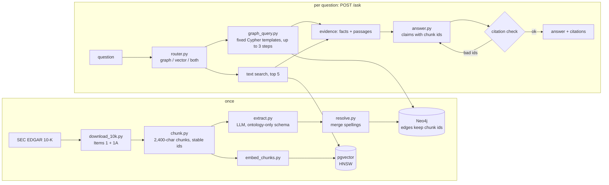

# Knowledge Graph RAG over SEC 10-K Filings

> **Result:** on questions that join two facts (often from two different filings), accuracy went from **71% → 93%** vs. a vector-only RAG baseline. Overall **76% → 84%** on 58 questions, and **84% → 89%** on 19 held-out questions, at **4.9 s p95** and **$0.0017 per question**. Every claim cites the filing passage it came from, and the citations are checked by code.

Corpus: the latest 10-K of NVIDIA, AMD and Intel (Item 1 Business + Item 1A Risk Factors) → 334 chunks → a graph of 655 entities and 1,088 relationships.

## Benchmark

Both systems use the same model (`gpt-4.1-mini`), the same chunks and the same citation rules. Grading is by keywords (not an LLM judge), checked against the filing text, not the graph.

| Question type | n | Vector RAG (baseline) | Graph RAG |
|---|---|---|---|
| 1-hop (one fact) | 26 | 77% | 81% |
| **2-hop** (join two facts) | 14 | 71% | **93%** |
| 3-hop | 5 | 80% | 80% |
| Aggregation (lists, counts) | 6 | 50% | 67% |
| Out of scope (must refuse) | 7 | 100% | 100% |
| **All** | **58** | **76%** | **84%** |
| **Held-out set** (never used while fixing) | 19 | 84% | 89% |

| | Vector RAG | Graph RAG |
|---|---|---|
| Latency p50 / p95 | 1.6 s / 2.4 s | 3.4 s / 4.9 s |
| Cost per question | $0.0008 | $0.0017 |
| One-time ingestion | $0.003 (embeddings) | $0.34 (extraction, 334 chunks) + $0.003 |

The example that shows the difference — *"Which supplier do NVIDIA and AMD share?"*
- **Vector RAG:** "Intel" ❌ (it retrieved chunks about competitors; the two TSMC passages are in different filings and neither ranked in the top 5).
- **Graph RAG:** "TSMC and Samsung" ✅, citing `NVDA-…6637efa5bd47` and `AMD-…253ca06db1dd`.

Other measurements:
- **Text retrieval** (25 hand-labelled questions): hit@5 = 0.80, recall@5 = 0.68. HNSW matches exact search 100% at `ef_search ≥ 20`.
- **Router**: 14/14 held-out questions routed correctly.
- **Entity resolution**: 694 names → 655 nodes, 18 merges, all checked by hand, 0 wrong.

Reproduce: `uv run python src/benchmark.py` and `uv run python src/benchmark.py eval/benchmark_holdout.json`. Every answer is saved in `eval/results/`.

## Architecture



The **chunk id** is the thread through everything: graph edges store the ids of the chunks they were extracted from, pgvector rows use the same ids, and every claim in an answer cites them.

## Design decisions

1. **The LLM never writes Cypher.** It picks one of 14 fixed, hand-written templates and names the entities; values go in as `$parameters`, and labels are checked against the ontology. Trade-off: questions outside the templates fall back to text search instead of getting a custom query.
2. **Citations are checked by code, per claim.** The answer is a list of claims, each with its chunk ids. Any id not in the evidence, or any uncited claim, triggers one retry, then "not in the filings". Trade-off: about one extra LLM call when it fails, and some true but uncited statements are dropped.
3. **Chained graph steps instead of free-form graph search.** "Where is the company whose CFO is Colette Kress headquartered?" becomes `employer_of [Kress] → locations_of [#1]`. Trade-off: at most 3 steps and 3 carried answers per step.
4. **Route, then fall back.** A small router picks graph, vector or both; if the graph returns nothing, or its facts don't answer the question, text search is added and the answer is retried. Trade-off: graph answers cost ~2× a plain RAG answer.
5. **Entity resolution = normalisation + embeddings + rules.** Embeddings alone merged different products ("Ryzen" + "Ryzen PRO") and missed real matches ("Samsung" vs "Samsung Electronics", 0.85). A number guard, a product generic-word rule and a small alias table fixed both.

## What did not work

- **The first graph version lost to the baseline (71% vs 74%).** Each question ran one fixed query, so anything needing a chain ("the company that…") or three companies failed and was refused. Chained steps, N-company "shared" queries and a text retry brought it to 84%. That 58-question set was used to find these problems, which is why the held-out set exists — and on it the gain is only 1 question out of 19, so it is a direction, not proof.
- **Extraction errors flow straight into answers.** The graph has `Samsung SUPPLIES Intel`, but Intel names Samsung as a *competitor*; "Which foundry supplies all three?" therefore answers "TSMC and Samsung". There is also a junk node, `Competitors`. Keyword grading doesn't catch an extra wrong claim, so the true accuracy on such questions is a little lower than shown.
- **Router confidence is not a useful signal.** The model reports 0.90–0.95 for nearly every question, so the low-confidence fallback never fired. The decision log (`data/logs/router.jsonl`) is the real safety net.
- **Text search can't tell companies apart.** For "Who manufactures NVIDIA's wafers?" the top hit is an AMD chunk about TSMC. A ticker filter on the query would help the baseline.
- **Run-to-run noise.** The baseline scored 74% and 76% on two runs with no code change, so differences of ±2 points mean nothing at this size.

## Setup

Requires Python 3.12, [uv](https://docs.astral.sh/uv/) and Docker.

```bash
cp .env.example .env            # add OPENAI_API_KEY, NEO4J_PASSWORD, SEC_USER_AGENT
docker compose up -d            # Neo4j (http://localhost:7474) + Postgres with pgvector
uv sync

# ingestion (once, ~$0.35)
uv run python src/download_10k.py
uv run python src/chunk.py
uv run python src/extract.py    # cached per chunk; re-runs are free
uv run python src/resolve.py
uv run python src/load_graph.py # safe to re-run: MERGE, counts don't change
uv run python src/embed_chunks.py

# ask
uv run uvicorn api:app --app-dir src --port 8000
curl -s localhost:8000/ask -H 'content-type: application/json' \
  -d '{"question": "Which supplier do NVIDIA and AMD share?"}'
```
